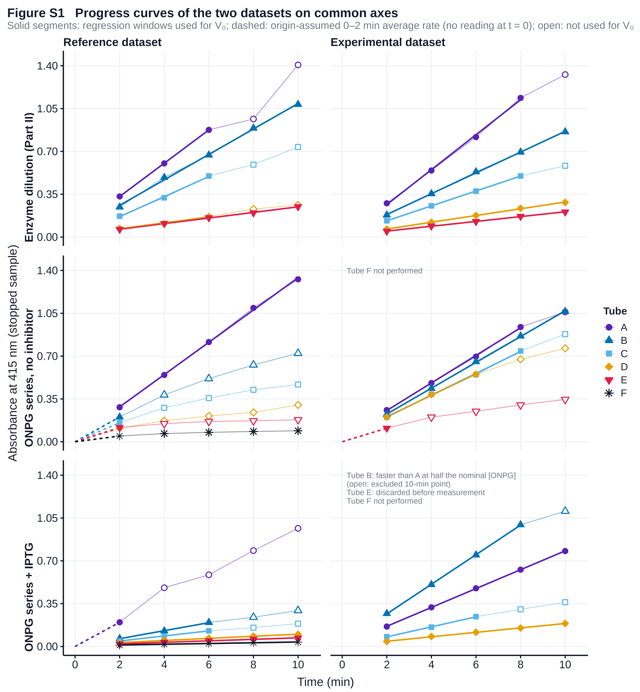
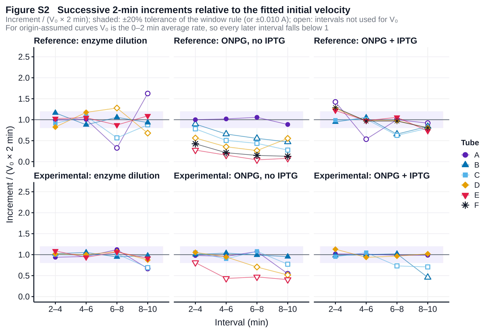
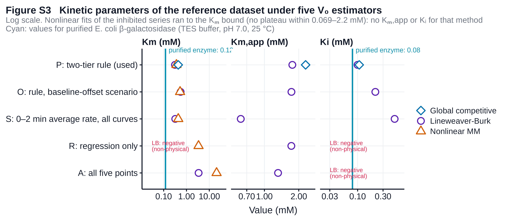
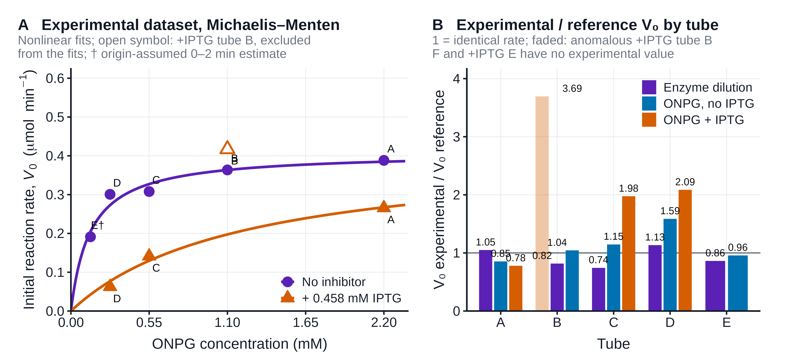

# Figures

Main figures (`figures/`) are drawn from the reference dataset (course-provided measurements, used for the Results section at the instructor's direction); supplementary figures (`figures/supplementary/`) hold the experimental dataset (our own printouts), diagnostics and sensitivity analyses. All figures: 600 dpi PNG plus vector PDF, generated by `R/07_generate_figures.R` and `R/07b_supplementary_figures.R`. Conventions: filled symbol, observation used for V₀; open symbol, observation retained but not used; solid line, fitted initial window; dashed segment from the origin, origin-assumed 0–2 min average rate (A₄₁₅(2 min)/2 min with A₄₁₅ = 0 assumed at t = 0, where no reading exists); dotted line, extrapolation; † marks such an origin-assumed estimate, which is an average rate over the first interval rather than a measured instantaneous initial velocity. Each condition was measured once, so no error bars are shown.

## Figure 1. o-Nitrophenol absorbs maximally at 415 nm and obeys the Beer–Lambert law to 0.43 mM

**(A)** Absorbance spectrum of 0.333 mM ONP (manual tube 4: 1.0 mL of 1 mM ONP + 1.0 mL Z buffer + 1.0 mL 1 M Na₂CO₃) read from 465 to 385 nm in 5 nm steps against the Z buffer/Na₂CO₃ blank (reference Part I). Points are the readings, the line a spline through them, the dashed line the maximum at 415 nm (A = 1.723); the shaded band (410–420 nm) lies within 2% of the maximum, so 415 nm was used for all kinetic measurements. **(B)** Standard curve at 415 nm for 1 mM ONP diluted to 0.083–0.533 mM in the same 3.0 mL matrix ([ONP] = 1 mM × V/3.0 mL; mapping of the reported readings to the manual's preparations in Table S1). Filled points and the line are the least-squares calibration over the linear region (shaded, 0.083–0.433 mM, chosen by the same increment rule used for progress curves): A₄₁₅ = 5.222[ONP] − 0.022, R² = 0.9988, n = 5, giving ε = 5.22 ± 0.10 A mM⁻¹ cm⁻¹ (5222 M⁻¹ cm⁻¹). The zero-concentration point (×, reported as 0) is shown but not fitted. The 0.533 mM standard (open, A = 3.24) lay +17% above the line and was excluded; the cause of the deviation cannot be identified from a single reading (see text). The calibration converts every velocity in this report from ΔA₄₁₅ min⁻¹ to product formed.

## Figure 2. Initial velocity rose approximately in proportion to the amount of β-galactosidase

**(A)** Progress curves (A₄₁₅ of 2.0 mL aliquots stopped with 1.0 mL 1 M Na₂CO₃) for 2.20 mM ONPG hydrolysed by 1.00, 0.75, 0.50, 0.25 and 0.15 relative amounts of the standardised enzyme (tubes A–E; reference Part II). Lines are least-squares fits to the initial linear window chosen by the operational rule (Methods); the 8-min readings of tubes A and C fell far below their initial trend and were excluded (open), while tubes B and E were linear to 10 min. V₀ ranged from 0.136 (A) to 0.023 (E), a 5.9-fold span for a 6.7-fold change in enzyme. **(B)** V₀, converted with ε = 5.22 mM⁻¹ cm⁻¹ to μmol ONP min⁻¹ per 12.0 mL assay, against relative enzyme concentration. Line: proportional model through the origin, V₀ = 0.481 × E (R² about the mean 0.972); a free-intercept fit (intercept -0.0006 μmol min⁻¹, not distinguishable from zero, p = 0.98) coincides with it and is not drawn; letters identify the tubes. Relative rates were 1.00, 0.77, 0.60, 0.18, 0.17 for relative enzyme 1.00, 0.75, 0.50, 0.25, 0.15: velocity rose approximately in proportion to enzyme, but the rate per unit enzyme ranged from 0.71 (D) to 1.21 (C) and tubes D and E gave nearly equal rates despite a 1.7-fold difference in enzyme.

## Figure 3. Product formation slowed as substrate fell and when IPTG was present

**(A)** Progress curves for 0.2 mL enzyme acting on 2.20, 1.10, 0.55, 0.275, 0.1375 and 0.069 mM ONPG in 12.0 mL Z buffer at room temperature (tubes A–F; reference Part III, no inhibitor). Only tube A stayed linear to 10 min (V₀ = 0.132 ΔA₄₁₅ min⁻¹, regression); in tubes B–F the later increments fell below the first, so no linear window could be fitted and their V₀ is the origin-assumed 0–2 min average rate, A₄₁₅(2 min)/2 min (†; dashed, × marks the assumed origin; dotted extrapolation). No reading exists at t = 0, so this is an average rate over the first interval, not a measured instantaneous initial velocity, and whether it under- or overestimates the true V₀ depends on the unmeasured early course of each curve. As a sensitivity scenario, assuming instead a t = 0 absorbance equal to the median intercept of the curves that were linear (0.013 A; range -0.020 to 0.059 A) lowers each 0–2 min estimate by about 0.006 ΔA₄₁₅ min⁻¹ (estimator O, Figure S3); intercepts of other reactions do not bound the baseline of these curves. Later points (open) were not used. **(B)** The same six tubes with 0.458 mM IPTG (1.0 mL of 5.5 mM IPTG per 12.0 mL; reference Part III), on a smaller absorbance scale. Tube A is origin-assumed (its 4–10 min increments fell below the first); tubes B–F were fitted by regression over the filled points. The uninhibited velocities rose 5.6-fold from 0.069 to 2.20 mM ONPG and approached a plateau (Figure 4A): Lineweaver–Burk Kₘ = 0.31 mM, Vₘₐₓ = 0.477 μmol min⁻¹ (R² = 0.928); direct nonlinear fit Kₘ = 0.36 ± 0.13 mM, Vₘₐₓ = 0.494 ± 0.059 μmol min⁻¹ (R² = 0.919). Five of six uninhibited V₀ values are origin-assumed 0–2 min estimates, so Kₘ depends on how the initial rate is estimated (Figure S3).

## Figure 4. β-Galactosidase approached saturation with ONPG, and IPTG raised the apparent Kₘ

**(A)** V₀ against [ONPG] without inhibitor (circles) and with 0.458 mM IPTG (triangles), from the progress curves in Figure 3 (1.0 mL of 5.5 mM IPTG per 12.0 mL tube; reference Part III, tubes A–F). Dashed curves are the hyperbolae implied by the two Lineweaver–Burk lines in B; solid curves are a single competitive-inhibition model fitted to both series at once (shared Vₘₐₓ = 0.53 ± 0.07 μmol min⁻¹, Kₘ = 0.44 ± 0.17 mM, Kᵢ = 0.107 ± 0.042 mM; the shared Vₘₐₓ is an assumption of this model, not a result). With IPTG, V₀ fell to 75% of the uninhibited value at 2.20 mM ONPG and to 13% at 0.069 mM: inhibition grew as substrate fell. **(B)** Double-reciprocal plot of the same velocities. No inhibitor: 1/V₀ = 0.66(1/[S]) + 2.10, R² = 0.928, giving Vₘₐₓ = 0.477 μmol min⁻¹ and Kₘ = 0.31 mM. + IPTG: 1/V₀ = 6.24(1/[S]) + 3.55, R² = 0.988, giving apparent Vₘₐₓ = 0.282 μmol min⁻¹ and apparent Kₘ = 1.76 mM (5.6-fold increase). Kᵢ = [I]/(Kₘ,app/Kₘ − 1) = 0.458/(1.76/0.31 − 1) = 0.100 mM. The inhibited series shows no plateau within the tested range, so its apparent Vₘₐₓ rests on an extrapolated intercept (3.55 ± 2.33) and is poorly determined; the shift of the x-intercept (−1/Kₘ) from -3.19 to -0.57 mM⁻¹ is the better-determined feature. A pure noncompetitive model fitted to the same twelve points (shared Kₘ, Vₘₐₓ reduced) left a residual sum of squares 1.9 times larger than the competitive model (0.0371 against 0.0194); the pattern is therefore consistent with competitive inhibition, with Kᵢ of the order of 0.1 mM by this method. † marks origin-assumed 0–2 min estimates.

## Supplementary figures (`figures/supplementary/`)

### Figure S1. Progress curves of the experimental dataset beside the reference dataset

Progress curves from our 14 GENESYS 10S printouts (right column; 7 and 11 September 2026) plotted on the same axes as the reference dataset (left column) for the three experiments. Solid segments are the regression windows and dashed segments the origin-assumed 0–2 min average rates used for V₀ under the identical rule. The standard tube (A: 0.2 mL enzyme, 2.20 mM ONPG) agreed between the two datasets within 5% (enzyme dilution) and 15% (substrate series). Our low-substrate tubes without inhibitor stayed linear longer than the reference tubes (only tube E was non-linear from the outset), and our inhibited tubes C and D ran about twice as fast as the reference tubes. Our inhibited tube B (open) ran faster than tube A at half the nominal substrate and is excluded from kinetic fits; our inhibited tube E has no data (sample discarded); tube F was not performed on either day.

### Figure S2. Increment diagnostics behind every V₀ decision

For each of the 31 measured curves, every successive 2-min increment divided by the increment predicted by the fitted V₀ (V₀ × 2 min). A value of 1 means the interval ran at the fitted initial rate; the shaded band is the acceptance window of the rule (±20% or ±0.010 A, whichever is larger). Open symbols are intervals not used for V₀. For curves with no initial linear portion (reference no-IPTG B–F, reference +IPTG A, experimental no-IPTG E) the reference V₀ is the origin-assumed 0–2 min average rate, so all later intervals fall below 1, showing how the measured increments declined: to 35–60% of the first-interval rate by the second interval in the reference uninhibited tubes B–F.

### Figure S3. Sensitivity of the kinetic parameters to the V₀ estimator

Kₘ (no inhibitor), apparent Kₘ (+IPTG) and Kᵢ from the reference dataset under five ways of estimating V₀: A, regression on all five points of every curve; R, the initial-window regression for every curve; S, the origin-assumed 0–2 min average rate for every curve; O, the two-tier rule under the baseline-offset scenario, in which each 0–2 min estimate is recomputed with a t = 0 absorbance equal to the median intercept of the linear curves (0.013 A; an assumption transferred between reactions, not a measured baseline); P, the two-tier rule used in the Results. Circles, Lineweaver–Burk; triangles, nonlinear Michaelis–Menten; diamond, global competitive fit. With regression-only V₀ the uninhibited Lineweaver–Burk line has a negative intercept (non-physical Kₘ and Vₘₐₓ, noted in red), and with all five points Kₘ exceeds 3 mM, because both estimators average over the falling phase of the curved low-substrate tubes. The offset scenario moves Kₘ from 0.31 to 0.55 mM and Kᵢ from 0.10 to 0.22 mM; applying the 0–2 min average rate to every curve (S) gives Kᵢ = 0.50 mM, because for the inhibited tubes, which were linear over 2–10 min, that estimate replaces a five-point regression with a single interval. These are alternative method-dependent estimates, not a confidence interval for Kᵢ. Cyan lines: Kₘ = 0.12 mM and Kᵢ = 0.08 mM reported for purified E. coli β-galactosidase with ONPG in TES buffer, pH 7.0, 25 °C.

### Figure S4. Kinetic analysis of the experimental dataset

**(A)** Michaelis–Menten representation of our Part III data with the same V₀ rule and units as the Results, with the anomalous +IPTG tube B (open) excluded and +IPTG tube E absent; † marks an origin-assumed 0–2 min estimate. Nonlinear fits: Kₘ = 0.14 mM, Vₘₐₓ = 0.41 μmol min⁻¹ without inhibitor; apparent Kₘ = 1.21 mM, apparent Vₘₐₓ = 0.41 with IPTG (ratio 1.01); Kᵢ = 0.059 mM. **(B)** Ratio of our V₀ to the reference V₀ for every tube measured in both datasets. The standard tube agreed within 5–15%; our uninhibited tube D and inhibited tubes C and D ran 1.6- to 2.1-fold faster; our inhibited tube B (faded) ran 3.7-fold faster than the reference tube B.
