# Kinetics of *Escherichia coli* β-galactosidase with ONPG and its inhibition by IPTG: how initial-rate estimation and model choice shape K_m, V_max and K_i

**Experiment 2: Studying Enzyme Kinetics using Spectrophotometry**
Methods in Molecular and Cellular Biology, B241

Student: Almokhtar Aljarodi
Laboratory partner: Abdulrahman Khardali
Laboratory sessions: 7 September 2026 (Part II) and 11 September 2026 (Part III); report compiled {{DATE}}

## Summary

**Background.** Enzyme kinetics condenses an enzyme's response to substrate, inhibitor and its own amount into two constants, K_m and V_max, but the numbers obtained depend on how initial velocities are extracted from the measurements.

**Results.** *Escherichia coli* β-galactosidase acting on *o*-nitrophenyl-β-D-galactopyranoside (ONPG) was followed by stopping timed aliquots with Na₂CO₃ and reading the *o*-nitrophenol formed at {{lambda_max}} nm (ε = {{eps|2}} mM⁻¹ cm⁻¹, linear to {{lin_max_mM|2}} mM). In the course-provided reference dataset, initial velocity rose approximately in proportion to enzyme (R² = {{ed_r2|2}}); over 0.069 to 2.20 mM ONPG the velocity approached saturation, K_m = {{lbU_Km|2}} mM and V_max = {{lbU_Vmax|2}} µmol min⁻¹ by Lineweaver–Burk ({{nlU_Km|2}} mM and {{nlU_Vmax|2}} µmol min⁻¹ by nonlinear fitting); with 0.458 mM IPTG the apparent K_m rose {{Km_ratio_lb|1}}-fold, inhibition grew as substrate fell, and K_i was {{Ki_lb|2}} mM by the course method ({{Ki_lb|2}} to {{S_Ki|2}} mM across estimators). Our own measurements, analysed by the same rules, gave the same pattern.

**Conclusion.** The observations are consistent with competitive inhibition by IPTG; the constants are model-dependent estimates, not measured quantities.

**Significance.** Five of six uninhibited reference velocities rest on an assumed zero-time absorbance, so the analysis rule, not the equation, sets the uncertainty of K_m and K_i.

## Objectives

To test whether the initial velocity of β-galactosidase is proportional to enzyme concentration, to determine K_m and V_max for ONPG hydrolysis, and to establish whether IPTG inhibits the enzyme competitively from its effect on the apparent K_m and V_max and the derived K_i, while examining how the choice of initial-rate window and of fitting method changes each of these estimates.

## Introduction

Enzymes accelerate reactions by binding substrates at active sites, and the dependence of reaction velocity on substrate concentration is the most direct window on how they do it. Michaelis and Menten described this dependence by postulating a reversible enzyme–substrate complex that breaks down to product, which gives V₀ = V_max[S]/(K_m + [S]) (1, 2). V_max = k_cat[E]_T is the limiting velocity when every active site is occupied and is therefore proportional to the amount of enzyme; K_m is the substrate concentration at half-maximal velocity and sets how much substrate the enzyme needs to approach it. Lineweaver and Burk rearranged the equation into a straight line, 1/V₀ = (K_m/V_max)(1/[S]) + 1/V_max, whose intercepts give the two constants (3). The transformation is the course's required method and the classical teaching representation, but it stretches the low-substrate points, so small errors in the smallest velocities dominate the fitted line (4); a direct fit of the untransformed velocities weights every point equally. This is one of two questions I wanted to examine: how far the constants depend on the mathematics applied to the same measurements. The other is more basic: V₀ is defined at t = 0 but must be estimated from a few stopped samples, and which samples are used, whether a line or a first-interval average is taken, and whether the unmeasured starting absorbance is assumed to be zero are decisions that each change K_m.

β-Galactosidase (EC 3.2.1.23), the *lacZ* product of *Escherichia coli*, is a homotetramer of 1023-residue subunits that hydrolyses the β-1,4 glycosidic bond of lactose and of synthetic β-galactosides (5, 6). The chromogenic substrate ONPG is cleaved to galactose and *o*-nitrophenol. At alkaline pH *o*-nitrophenol exists as the yellow *o*-nitrophenolate anion, whose absorbance near 415 to 420 nm follows the Beer–Lambert law, A = εcl. Adding 1 M Na₂CO₃ to a timed aliquot both stops the reaction, by raising the pH far above the enzyme's working range, and develops the colour, so one reading gives the product formed up to that moment (7). A series of stopped samples builds a progress curve whose initial slope is V₀, the velocity before substrate depletion, product accumulation or enzyme instability slow the reaction. The stopped method needs only a fixed-wavelength spectrophotometer; its coarse 2-min time resolution is the origin of the analytical choices examined here.

Inhibitors reveal themselves by how they change K_m and V_max. A competitive inhibitor binds free enzyme at the active site and is displaced by substrate: it leaves V_max unchanged but raises the apparent Michaelis constant to K_m,app = K_m(1 + [I]/K_i), where K_i is the inhibitor's dissociation constant. A noncompetitive inhibitor inactivates a fraction of the enzyme whatever the substrate concentration, lowering V_max and leaving K_m unchanged (2). Isopropyl-β-D-thiogalactopyranoside (IPTG) is the thiogalactoside used as a gratuitous inducer of the *lac* operon because it induces the enzyme without being hydrolysed by it (8, 9). The same stability makes it a dead-end ligand of β-galactosidase: it occupies the galactose subsite of the active site, but its thioglycosidic bond is not cleaved, so it is expected to behave as a competitive inhibitor with K_i of the order of 0.1 mM (6, 10). The inducer of *lacZ* thus competes with the substrates of the enzyme it induces, the logic that underlies competitive drugs such as statins and many antivirals. Distinguishing the two mechanisms from data is less simple than textbook figures suggest: they differ only near saturation, and a competitive model fitted with a shared V_max cannot itself show that V_max was unchanged.

Here the ONP spectrum and standard curve were established, V₀ was measured against enzyme concentration at saturating ONPG and over a 32-fold range of ONPG with and without IPTG, and the analysis asks whether the velocities scale with enzyme, saturate with substrate and respond to IPTG as competition predicts, and how much each constant moves when the initial-rate rule or the fitting method changes.

## Experimental Procedure

All procedures followed the Experiment 2 laboratory manual (11) except for the modifications listed below. Z buffer (0.06 M Na₂HPO₄, 0.04 M NaH₂PO₄, 0.01 M KCl, 0.001 M MgSO₄, 0.05 M β-mercaptoethanol, pH 7.0), ONPG (1.0 mg mL⁻¹, 3.3 mM), IPTG (1.31 mg mL⁻¹, 5.5 mM), 1 mM ONP and 1 M Na₂CO₃ were provided, together with β-galactosidase standardised by the teaching staff to give A₄₁₅ = 1.20 to 1.30 after 10 min in the standard reaction. Reactions (12.0 mL, room temperature) were assembled as in the manual's tables with enzyme added last; 2.0 mL aliquots were stopped with 1.0 mL Na₂CO₃ at 2, 4, 6, 8 and 10 min and read at 415 nm against a Z-buffer blank in a GENESYS 10S UV-Vis spectrophotometer (1 cm path). Part I standards and the Part I blank contained Na₂CO₃ as specified in the manual.

**Datasets and modifications.** Two datasets were analysed: course-provided reference measurements supplied by Professor Samah Gadhoum (Parts I/II on 10 September 2026 and Part III on 13 September 2026) and an experimental dataset collected by our laboratory group. The reference measurements (Part I spectrum, ONP standard curve and enzyme-dilution series; Part III substrate series with and without IPTG, tubes A to F) were used for the primary kinetic analysis in the Results, as instructed. Our experimental measurements (Part II tubes A to E on 7 September; Part III tubes A to E without IPTG and A to D with IPTG on 11 September) were analysed with the identical procedure and are examined in the Discussion; they are not combined with the reference measurements in any curve. Deviations from the manual in our own sessions: Part I was performed by the teaching staff; in Part III, tube F was not performed and the IPTG tube E was discarded before measurement, so our inhibited series has four tubes. Our 70 readings (14 printouts) were transcribed and verified against the photographs (Table R1); every digit is kept, including the 10-min reading of inhibited tube B (1.106), which was excluded from that tube's regression; the whole tube was excluded from our inhibited fits (Discussion). The reference standard-curve table lists seven readings where the manual describes a blank and seven standards; the instructor confirmed that the first reading is the zero-concentration point (mapping in the Results).

**Data analysis.** Concentrations were calculated from the stated stock concentrations and the manual's volumes ([ONPG] = 3.3 mM × V/12.0 mL; [IPTG] = 5.5 mM × 1.0/12.0 = 0.458 mM; ONP standards 1 mM × V/3.0 mL). The manual asks for V₀ from the initial linear portion of each progress curve, with the points used identified. One rule was applied to all {{n_curves_total}} curves: the least-squares line A₄₁₅ = a + bt was fitted to the 2, 4 and 6 min points and extended one point at a time while the next increment lay within {{REL_TOL_pct|0}}% (or {{ABS_TOL|3}} A, whichever larger) of the increment predicted by the current line; V₀ = b. When the second and third increments both fell below the first by more than this tolerance, no linear window could be fitted and V₀ was taken as the average rate over the first interval, A₄₁₅(2 min)/2 min, which assumes A₄₁₅ = 0 at t = 0 because no reading exists there (flagged † throughout). This origin-assumed estimate is an average rate over 0 to 2 min, not a measured instantaneous initial velocity, and may lie below or above the true V₀. Four alternative estimators (regression only; the 0 to 2 min average rate for every curve; all five points; a baseline-offset scenario with the t = 0 absorbance set to the median intercept of the linear curves, an assumption rather than a measurement) test its sensitivity. The extinction coefficient was the slope of A₄₁₅ against [ONP] over the linear region chosen by the same increment rule. V₀ in ΔA₄₁₅ min⁻¹ was converted to µmol ONP min⁻¹ per assay as V₀/ε × 1.5 (the 2 mL aliquot was diluted with 1 mL stop reagent) × 12.0 mL (reaction volume); the manual's division by ε gives the cuvette rate in mM min⁻¹, and the two factors convert it to an amount per minute. K_m and V_max were obtained from the Lineweaver–Burk regression as required (V_max = 1/intercept, K_m = slope × V_max) and checked by unweighted nonlinear least squares on the velocity scale; K_i was calculated from K_m,app = K_m(1 + [I]/K_i). Competitive, pure noncompetitive and mixed models were also fitted to both series simultaneously. All calculations were performed in R 4.3.3 with tidyverse (12); scripts, data and outputs are public (Data and Code Availability). Each condition was measured once, so the uncertainties quoted are regression standard errors, not replicate variability, and the alternative estimators are different answers to the same data, not a confidence interval.

## Results

All values in this section are from the reference dataset: Parts I/II provided on 10 September 2026 and Part III on 13 September 2026 by Prof. Samah Gadhoum for use in the Results. Our own measurements (experimental dataset, Table R1) are analysed in the Discussion.

**1. Absorbance spectrum of o-nitrophenol.** The spectrum of 0.333 mM ONP (manual tube 4: [ONP] = 1 mM × 1.0 mL/3.0 mL) peaked at {{lambda_max}} nm (A = {{A_lmax|3}}; Table 1, Figure 1A); 410 to 420 nm lay within 2% of the maximum, so 415 nm was used for all kinetic measurements.

**Table 1. Absorbance spectrum of 0.333 mM ONP in Z buffer/1 M Na₂CO₃ (2:1), read against the Z buffer/Na₂CO₃ blank (reference Part I).**

{{TABLE:table_r1_spectrum}}

**2. Standard curve of o-nitrophenol.** The reference table reported seven readings (Table 2): the first (0) is the zero-concentration preparation (2.0 mL Z buffer + 1.0 mL Na₂CO₃), as the instructor confirmed, and the other six are manual standards 1 to 6 in order, anchored by the spectrum tube (standard 4, {{A_lmax|3}} at 415 nm, identical to the fifth reading). Standard 7 (0.667 mM) has no reported reading; whether it was unprepared or unreported is unknown, and no value was assumed. Absorbance was linear for the five standards from 0.083 to 0.433 mM, A₄₁₅ = {{eps|3}}[ONP] − {{eps_icpt_abs|3}} (R² = {{eps_r2|4}}; Figure 1B), giving ε = {{eps|2}} ± {{eps_se|2}} A mM⁻¹ cm⁻¹ ({{eps_origin|2}} through the origin). The 0.533 mM standard (A = {{excl_A|2}}) lay {{excl_pct|0}}% above the line and was excluded; including it would give ε = {{eps_all6|2}} and lower every V_max by 13%, leaving K_m and K_i unchanged.

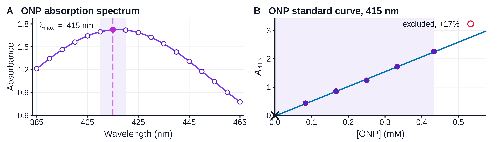

**Figure 1. ONP absorbs maximally at 415 nm and obeys the Beer–Lambert law to 0.43 mM.** (A) Spectrum of 0.333 mM ONP; points, readings; line, spline; dashed line, maximum; shaded, within 2% of it. (B) Standard curve; filled points and line, calibration over the shaded range (equation in the text); ×, zero-concentration point (not fitted); open point, the excluded 0.533 mM standard, 17% above the line. Reference Part I data.

**Table 2. ONP standard curve at 415 nm (reference Part I): reported readings, their assignment to the manual's preparations, [ONP] in the 3.0 mL cuvette (1 mM × V/3.0 mL) and use in the fit.**

{{TABLE:table2_onp_calibration}}

**3. Enzyme dilution.** At 2.20 mM ONPG, product formation was linear over an initial window in every tube (Figure 2A; Table 3). V₀ fell from {{e_dA_A|3}} ΔA₄₁₅ min⁻¹ with undiluted enzyme to {{e_dA_E|4}} at 0.15 of that amount ({{ed_fold_rate|1}}-fold for a {{ed_fold_enzyme|1}}-fold dilution). Sample calculation, tube A: {{e_dA_A|3}}/{{eps|2}} = 0.0260 mM min⁻¹ in the cuvette, × 1.5 = 0.0391 mM min⁻¹ in the reaction, × 12.0 mL = {{e_umol_A|3}} µmol min⁻¹; relative rate of tube B = {{e_dA_B|4}}/{{e_dA_A|3}} = {{e_rel_B|2}}. The relative rates (Table 3) were approximately proportional to enzyme (V₀ = {{ed_slope_umol|3}} × E µmol min⁻¹ through the origin, R² = {{ed_r2|3}}; free intercept {{ed_free_icpt_umol|4}}, p = {{ed_free_p|2}}; Figure 2B), although the rate per unit enzyme ranged from {{ed_rpe_min|2}} (tube D) to {{ed_rpe_max|2}} (tube C), and tubes D and E gave nearly equal rates despite 1.7-fold more enzyme in D.

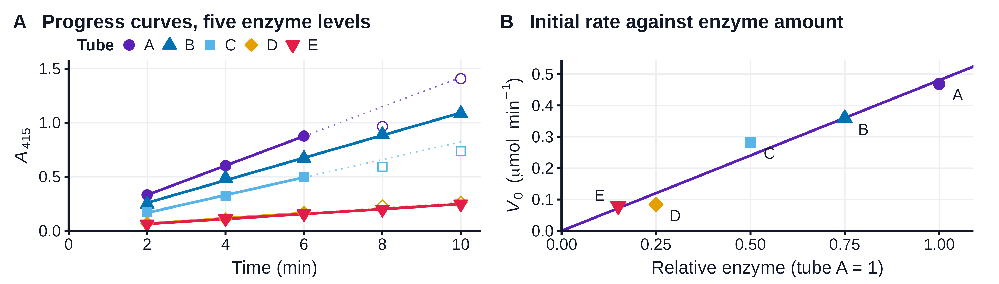

**Figure 2. Initial velocity rose approximately in proportion to the amount of β-galactosidase.** (A) Progress curves (A₄₁₅ of the stopped samples), 2.20 mM ONPG, 1.00 to 0.15 relative enzyme (tubes A to E); lines, fits to the initial linear window (filled, used; open, excluded; dotted, extrapolation); V₀ values in Table 3. (B) V₀ against relative enzyme (letters, tubes); line through the origin, V₀ = {{ed_slope_umol|3}} × E µmol min⁻¹ (R² = {{ed_r2|2}}); a free-intercept fit (intercept {{ed_free_icpt_umol|4}}, p = {{ed_free_p|2}}) coincides with it. n = 1 per tube; reference Part II data.

**Table 3. Enzyme dilution (reference Part II): A₄₁₅ of the stopped samples, points used, V₀ (ΔA₄₁₅ min⁻¹; µmol ONP min⁻¹ per assay, × {{k_umol|3}}), rate relative to tube A and rate per unit enzyme.**

{{TABLE:table_results_enzyme_dilution}}

**4. Michaelis–Menten kinetics without inhibitor.** Only the 2.20 mM tube remained linear to 10 min (V₀ = {{u_dA_A|3}} ΔA₄₁₅ min⁻¹); in tubes B to F the later increments fell below the first, so V₀ is the origin-assumed 0 to 2 min average rate (†; Figure 3A, Table 4). V₀ rose {{u_fold_AF|1}}-fold over the 32-fold substrate range and flattened above 1 mM (Figure 4A). Sample calculation, tube B: [S] = 3.3 mM × 4.0/12.0 = 1.10 mM; V₀ = {{u_dA_B|3}}/{{eps|2}} × 1.5 × 12.0 = {{u_umol_B|3}} µmol min⁻¹; 1/[S] = 0.909 mM⁻¹, 1/V₀ = 2.87 min µmol⁻¹. Lineweaver–Burk regression (Figure 4B): 1/V₀ = {{lbU_slope|3}}(1/[S]) + {{lbU_icpt|3}} (R² = {{lbU_r2|3}}), so V_max = 1/{{lbU_icpt|3}} = {{lbU_Vmax|3}} µmol min⁻¹ and K_m = {{lbU_slope|3}} × {{lbU_Vmax|3}} = {{lbU_Km|2}} mM; the nonlinear fit gave K_m = {{nlU_Km|2}} ± {{nlU_Km_se|2}} mM and V_max = {{nlU_Vmax|3}} ± {{nlU_Vmax_se|3}} µmol min⁻¹ (Table 5).

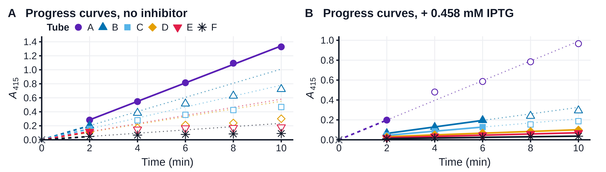

**Figure 3. Product formation slowed as substrate fell and when IPTG was present.** Progress curves for 2.20 to 0.069 mM ONPG (tubes A to F) without inhibitor (A) and with 0.458 mM IPTG (B; smaller absorbance scale). Symbols as in Figure 2A; dashed from ×, origin-assumed 0 to 2 min average rate (A₄₁₅ = 0 assumed at t = 0; tubes B to F in A, tube A in B). V₀ values in Table 4; reference Part III data.

**Table 4. Substrate series without and with 0.458 mM IPTG (reference Part III): A₄₁₅ of stopped samples, V₀ (ΔA₄₁₅ min⁻¹; µmol min⁻¹ per assay) and Lineweaver–Burk reciprocals (1/[S], mM⁻¹; 1/V₀, min µmol⁻¹); †, origin-assumed 0 to 2 min average rate; others, regression.**

{{TABLE:table_results_substrate}}

**5. Michaelis–Menten kinetics with IPTG.** With 0.458 mM IPTG every tube was slower (Figure 3B), by {{inh_pct_A|0}}% at 2.20 mM ONPG and {{inh_pct_F|0}}% at 0.069 mM, so inhibition grew as substrate fell (Figure 4A). The Lineweaver–Burk line steepened {{lb_slope_ratio|1}}-fold, 1/V₀ = {{lbI_slope|2}}(1/[S]) + {{lbI_icpt|2}} (R² = {{lbI_r2|3}}; Figure 4B), giving K_m,app = {{lbI_Km|2}} mM ({{Km_ratio_lb|1}}-fold increase) and V_max,app = {{lbI_Vmax|3}} µmol min⁻¹ from an extrapolated intercept ({{lbI_icpt|2}} ± {{lbI_icpt_se|2}}). K_i = [I]/(K_m,app/K_m − 1) = 0.458/({{lbI_Km|2}}/{{lbU_Km|2}} − 1) = {{Ki_lb|3}} mM. A competitive model fitted to both series (shared V_max = {{g_Vmax|2}} ± {{g_Vmax_se|2}} µmol min⁻¹, K_m = {{g_Km|2}} ± {{g_Km_se|2}} mM, K_i = {{g_Ki|3}} ± {{g_Ki_se|3}} mM) left a residual sum of squares {{gn_rss_ratio|1}} times smaller than a noncompetitive model with the same number of parameters, and a mixed model reduced to it (Table 5).

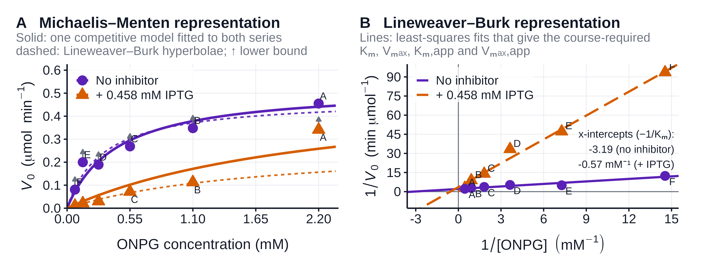

**Figure 4. β-Galactosidase approached saturation with ONPG, and IPTG raised the apparent K_m.** (A) V₀ against [ONPG] without (circles) and with 0.458 mM IPTG (triangles), from Figure 3; solid, competitive model fitted to both series (shared V_max assumed); dashed, Lineweaver–Burk hyperbolae; †, origin-assumed. (B) Lineweaver–Burk plot; x-intercepts −1/K_m = {{lbU_xint|2}}, −1/K_m,app = {{lbI_xint|2}} mM⁻¹. Reference Part III data.

**Table 5. Kinetic parameters (reference Part III; K_m, K_i in mM; V_max in µmol min⁻¹ per assay; ± SE of the fit) by Lineweaver–Burk (course method) and nonlinear fits; app., apparent (with IPTG); n.d., no plateau, not determinable; global fits share V_max (competitive) or K_m (noncompetitive) between the series; RSS, residual sum of squares.**

{{TABLE:table5_kinetic_parameters}}

## Discussion

The reference dataset showed the expected relationships between enzyme concentration, substrate availability and velocity: V₀ increased approximately in proportion to enzyme amount at 2.20 mM ONPG (R² = {{ed_r2|2}}), approached a plateau as substrate increased, and fell in the presence of IPTG, especially at low ONPG. The Lineweaver–Burk estimates were K_m = {{lbU_Km|3}} mM and V_max = {{lbU_Vmax|3}} µmol min⁻¹ without IPTG, compared with an apparent K_m = {{lbI_Km|3}} mM with IPTG. Yet these values depend on how V₀ was estimated. Five of six uninhibited reference tubes lacked a defensible early linear window, so their rates were taken as 0 to 2 min averages assuming zero absorbance at time zero, which was never measured. Under alternative rate-estimation scenarios the kinetic estimates changed substantially (K_m {{lbU_Km|2}} to {{O_Km|2}} mM, K_i {{Ki_lb|2}} to {{S_Ki|2}} mM; Table 5); these scenarios are not confidence intervals. Lineweaver–Burk particularly magnifies changes in small velocities at low substrate concentration (4), whereas an untransformed nonlinear fit estimated K_m = {{nlU_Km|3}} ± {{nlU_Km_se|3}} mM. For me, the important distinction is between the reaction that was measured and the numerical constants inferred from it.

The inhibitor results were consistent with competition for the active site but did not establish that mechanism uniquely. A global competitive model had approximately {{gn_rss_ratio|1}}-fold lower residual sum of squares than a noncompetitive fit of the same size (Table 5); however, the competitive model shares V_max by construction, so its fit cannot demonstrate that V_max was experimentally unchanged. The inhibited reference measurements also did not establish a clear saturation plateau. Consequently, the apparent V_max = {{lbI_Vmax|3}} µmol min⁻¹ from the reciprocal intercept is weakly constrained. The Lineweaver–Burk-derived K_i was approximately {{Ki_lb|3}} mM, while the global competitive fit gave {{g_Ki|3}} ± {{g_Ki_se|3}} mM. These are comparable in order of magnitude to the native-enzyme IPTG K_i ≈ 0.08 mM reported by Juers et al. (10). The reference K_m ({{lbU_Km|2}} to {{nlU_Km|2}} mM) exceeded the published native-enzyme ONPG K_m ≈ 0.12 mM (10), but differences in buffer, temperature, enzyme preparation and the early sampling interval limit direct comparisons. In particular, 2-min intervals cannot recover an instantaneous rate after a curve has already bent.

Our shared laboratory measurements helped reveal why the analysis matters. The uninhibited experimental series gave K_m = {{s_lb_Km|3}} mM by Lineweaver–Burk, or {{s_nl_Km|3}} ± {{s_nl_Km_se|3}} mM and V_max = {{s_nl_Vmax|3}} ± {{s_nl_Vmax_se|3}} µmol min⁻¹ by direct nonlinear fitting. Four of five uninhibited tubes had usable measured-time windows, unlike the reference series. After excluding the anomalous inhibited tube B, the three remaining inhibited tubes gave K_i = {{s_nl_Ki|3}} ± {{s_nl_Ki_se|3}} mM from separate nonlinear fits; a global competitive model gave K_i = {{s_g_Ki|3}} ± {{s_g_Ki_se|3}} mM. Both estimates depend on the exclusion and the competitive model. Tube B was the observation I could not reconcile with the expected response: its inhibited rate was approximately {{s_B_over_control_pct|0}}% higher than its uninhibited control at the same ONPG concentration and about {{s_blackB_over_A|2}}-fold the inhibited rate in tube A despite half the substrate. Incorrect stopping or sampling times, a reagent-volume difference or an incorrect IPTG preparation could contribute, but the original records cannot distinguish these hypotheses. We therefore retained the raw value and assessed fits with and without the tube. Including it made the experimental Lineweaver–Burk apparent K_m extremely unstable (approximately {{s_lb_Kmapp_withB|0}} mM); that value is a reciprocal-fit artifact rather than evidence of an actual {{s_lb_Kmapp_withB|0}} mM affinity constant. Because inhibited tube E was discarded before measurement, only three inhibited points remained after excluding B, so the uncertainty should not be understated.

**Conclusion.** The experiment showed that β-galactosidase activity increased with enzyme amount, responded to ONPG in a saturable manner and was inhibited by IPTG in a pattern consistent with competitive inhibition. The principal limitation is not a missing equation but how much the measured time courses constrain the parameters: assumptions about time zero, selection of fitting windows and one anomalous tube can materially change K_m and K_i. If repeating the experiment, I would collect 30-s early measurements including an actual initial baseline, replicate the reactions, verify enzyme and inhibitor preparation, and extend the inhibited ONPG range to observe saturation. Those changes would test the model more rigorously rather than merely make the fitted line look better.

## Data and Code Availability

The raw data (our 14 printouts and their transcription; the reference values as received), the R scripts, processed tables, figures and report sources are in the public repository https://github.com/almokhtar8-stack/exp2; `Rscript R/run_all.R` regenerates every number, table and figure. Instructor correspondence and course documents are not redistributed.

## References

1. Michaelis, L., and Menten, M. L. (1913) Die Kinetik der Invertinwirkung, Biochem. Z. 49, 333-369.
2. Johnson, K. A., and Goody, R. S. (2011) The original Michaelis constant: translation of the 1913 Michaelis-Menten paper, Biochemistry 50, 8264-8269. DOI 10.1021/bi201284u
3. Lineweaver, H., and Burk, D. (1934) The determination of enzyme dissociation constants, J. Am. Chem. Soc. 56, 658-666. DOI 10.1021/ja01318a036
4. Dowd, J. E., and Riggs, D. S. (1965) A comparison of estimates of Michaelis-Menten kinetic constants from various linear transformations, J. Biol. Chem. 240, 863-869. DOI 10.1016/S0021-9258(17)45254-9
5. Jacobson, R. H., Zhang, X.-J., DuBose, R. F., and Matthews, B. W. (1994) Three-dimensional structure of β-galactosidase from E. coli, Nature 369, 761-766. DOI 10.1038/369761a0
6. Juers, D. H., Heightman, T. D., Vasella, A., McCarter, J. D., Mackenzie, L., Withers, S. G., and Matthews, B. W. (2001) A structural view of the action of Escherichia coli (lacZ) β-galactosidase, Biochemistry 40, 14781-14794. DOI 10.1021/bi011727i
7. Miller, J. H. (1972) Experiments in Molecular Genetics, pp 352-355, Cold Spring Harbor Laboratory, Cold Spring Harbor, NY.
8. Jacob, F., and Monod, J. (1961) Genetic regulatory mechanisms in the synthesis of proteins, J. Mol. Biol. 3, 318-356. DOI 10.1016/S0022-2836(61)80072-7
9. Herzenberg, L. A. (1959) Studies on the induction of β-galactosidase in a cryptic strain of Escherichia coli, Biochim. Biophys. Acta 31, 525-538. DOI 10.1016/0006-3002(59)90029-0
10. Juers, D. H., Rob, B., Dugdale, M. L., Rahimzadeh, N., Giang, C., Lee, M., Matthews, B. W., and Huber, R. E. (2009) Direct and indirect roles of His-418 in metal binding and in the activity of β-galactosidase (E. coli), Protein Sci. 18, 1281-1292. DOI 10.1002/pro.140
11. Biological and Environmental Science and Engineering Division, KAUST. (2026) Methods in Molecular and Cellular Biology B241 Laboratory Manual, Experiment 2: Studying Enzyme Kinetics using Spectrophotometry, pp 1-19.
12. Wickham, H., Averick, M., Bryan, J., Chang, W., D'Agostino McGowan, L., François, R., Grolemund, G., Hayes, A., Henry, L., Hester, J., Kuhn, M., Pedersen, T. L., Miller, E., Bache, S. M., Müller, K., Ooms, J., Robinson, D., Seidel, D. P., Spinu, V., Takahashi, K., Vaughan, D., Wilke, C., Woo, K., and Yutani, H. (2019) Welcome to the tidyverse, J. Open Source Softw. 4, 1686. DOI 10.21105/joss.01686

## VII. Questions – Answer on this form and submit with your lab report

*Michaelis-Menten Kinetics*

**1. Sketch by hand a typical enzyme kinetic curve of [S] versus V. The maximum [S] should be about 4 times the Km. Draw lines at [S]=Km and V=Vmax. Make sure you get the slope at the origin ([S]=0) correct. Draw the asymptote (tangent line) at [S]=0.**

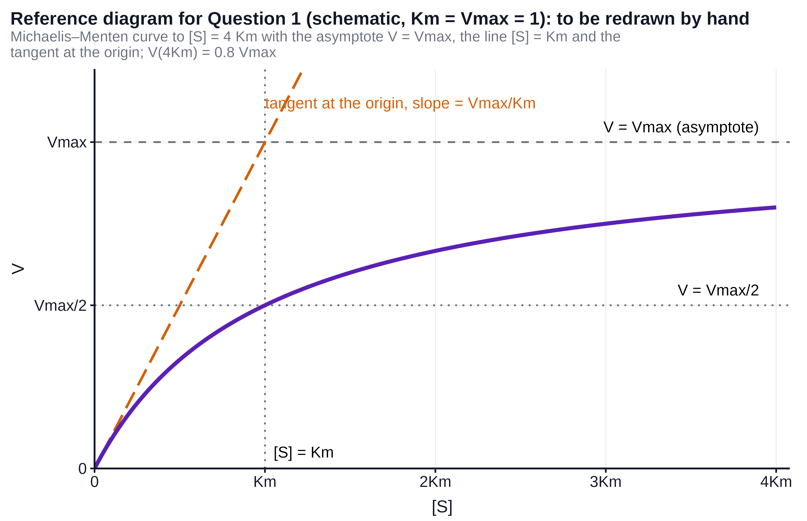

The curve is the hyperbola V = Vmax[S]/(Km + [S]), drawn to [S] = 4 Km. It leaves the origin with slope Vmax/Km (the first-order region, V ≈ (Vmax/Km)[S]), passes V = Vmax/2 at [S] = Km, and bends towards the asymptote V = Vmax, reaching 0.8 Vmax at [S] = 4 Km; the tangent at the origin meets the line V = Vmax at [S] = Km.

**2. What effect does altering Km have on Vmax?**

None. Vmax = kcat[E]T depends on the turnover number and the amount of enzyme; Km only moves the curve along the [S] axis (a mutation may change both constants, but that is two changes, not a consequence of one).

**3. What effect does altering [E] have on Km? Vmax?**

Km is unchanged, because it is a ratio of rate constants for the enzyme–substrate pair; Vmax changes in proportion to [E], as Figure 2 shows at 2.20 mM ONPG ({{ed_fold_rate|1}}-fold for a 6.7-fold dilution, approximately proportional).

**4. At what concentration of [S] is the initial velocity proportional to [E]?**

At every [S], provided [E] is much smaller than [S] so that the steady state holds: V₀ = kcat[E][S]/(Km + [S]) is linear in [E] for any fixed [S]. The proportionality constant depends on [S], so enzyme is assayed at saturating substrate ([S] much greater than Km), where V₀ ≈ Vmax = kcat[E] and small errors in [S] do not matter; that is why Part II used 2.20 mM ONPG.

*Competitive Inhibition*

**5. What effect does increasing [I] have on the apparent Vmax and Km?**

Apparent Vmax is unchanged, because sufficient substrate displaces the inhibitor; apparent Km increases linearly with [I], Km,app = Km(1 + [I]/Ki). Here 0.458 mM IPTG raised the apparent Km {{Km_ratio_lb|1}}-fold.

**6. What is the effect on the Km (apparent) when [I] = Ki; when [I] = 2Ki?**

Km,app = 2 Km when [I] = Ki and 3 Km when [I] = 2 Ki. (The observed {{Km_ratio_lb|1}}-fold increase corresponds to [I]/Ki = {{Km_ratio_lb|1}} − 1 = 4.6, i.e. Ki = 0.458/4.6 = {{Ki_lb|3}} mM.)

*Non-competitive Inhibition*

**7. What effect does increasing [I] have on the apparent Vmax and Km?**

Apparent Vmax falls as Vmax/(1 + [I]/Ki), because the inhibitor removes active enzyme regardless of [S]; apparent Km is unchanged, because the inhibitor binds E and ES equally and does not alter substrate affinity.

**8. What is the effect on Vmax when [I] = Ki; [I] = 9 Ki?**

Vmax,app = Vmax/2 when [I] = Ki and Vmax/10 when [I] = 9 Ki.

**9. Can you distinguish noncompetitive from competitive inhibition using just the activity at low substrate concentrations? (i.e. the slope of V versus [S] at the origin?) Why or why not? How much does the slope change?**

No. At low [S] the slope is Vmax,app/Km,app. For competitive inhibition it is Vmax/[Km(1 + [I]/Ki)]; for noncompetitive inhibition it is [Vmax/(1 + [I]/Ki)]/Km. For equal inhibitor dissociation constants in the two idealized models, both equal (Vmax/Km)/(1 + [I]/Ki), so the slope falls by the same factor 1/(1 + [I]/Ki) in both cases (halved at [I] = Ki; to about 18% at the [I]/Ki ≈ 4.6 of this experiment). The low-substrate slopes cannot distinguish them by themselves; the mechanisms differ at higher substrate concentrations, where the competitive curve recovers Vmax and the noncompetitive one does not.

**10. Given a series of enzyme preparations with differing activities, how can you distinguish between the presence of an inhibitor and varying amounts of the active enzyme? Explain, considering both competitive and non-competitive inhibitors.**

Measure full V₀ versus [S] curves rather than single activities. Different amounts of active enzyme change Vmax in proportion and leave Km identical (Lineweaver–Burk lines share the x-intercept). A competitive inhibitor leaves Vmax and raises Km (lines share the y-intercept), which cannot be mimicked by enzyme amount. A noncompetitive inhibitor lowers Vmax at constant Km and so mimics less enzyme kinetically; to separate the two, dilute the preparation and re-assay (a reversible inhibitor's effect weakens as [I] falls, so specific activity rises, whereas a true enzyme difference gives constant specific activity), mix preparations (activities of inhibitor-free preparations add; an inhibitor makes the mixture sub-additive), remove small molecules by dialysis or gel filtration, or measure enzyme independently (protein assay, immunoblot or active-site titration with a tight-binding ligand such as PETG).

## Raw Data

Our own instrument printouts (GENESYS 10S UV-Vis; 14 photographs, 70 readings, transcribed and verified value by value; Table R1) are appended below; the photographs reproduce the original printouts, which the course requires to be signed by a TA. The course-provided reference measurements used in the Results are reproduced as received in Tables 1 to 4 and in the repository (`data/raw/reference/`, transcribed from the course's files and cross-checked against them); our printout data are in `data/raw/experimental/` and the photographs in `report/raw_data_printouts/`.

**Table R1. Transcribed absorbance values from our printouts (experimental dataset; A₄₁₅ of stopped samples; NA = sample discarded before measurement; Part III + IPTG tube B 10 min = 1.106 retained as read). Printout labels: Day 1 = Part II (7 Sep 2026); Day 2 Blue = Part III without IPTG; Day 2 Black = Part III with IPTG (11 Sep 2026).**

{{TABLE:tableS2_experimental_raw_absorbance}}

Day 1 (7 Sep 2026, Part II, tubes A to E):

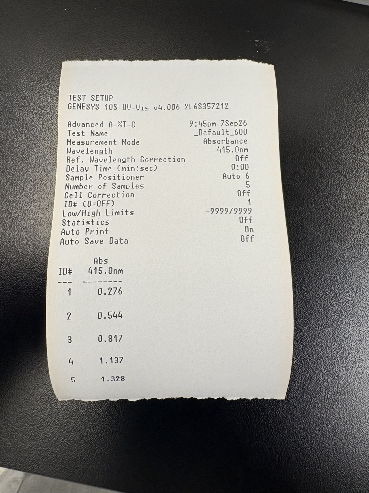 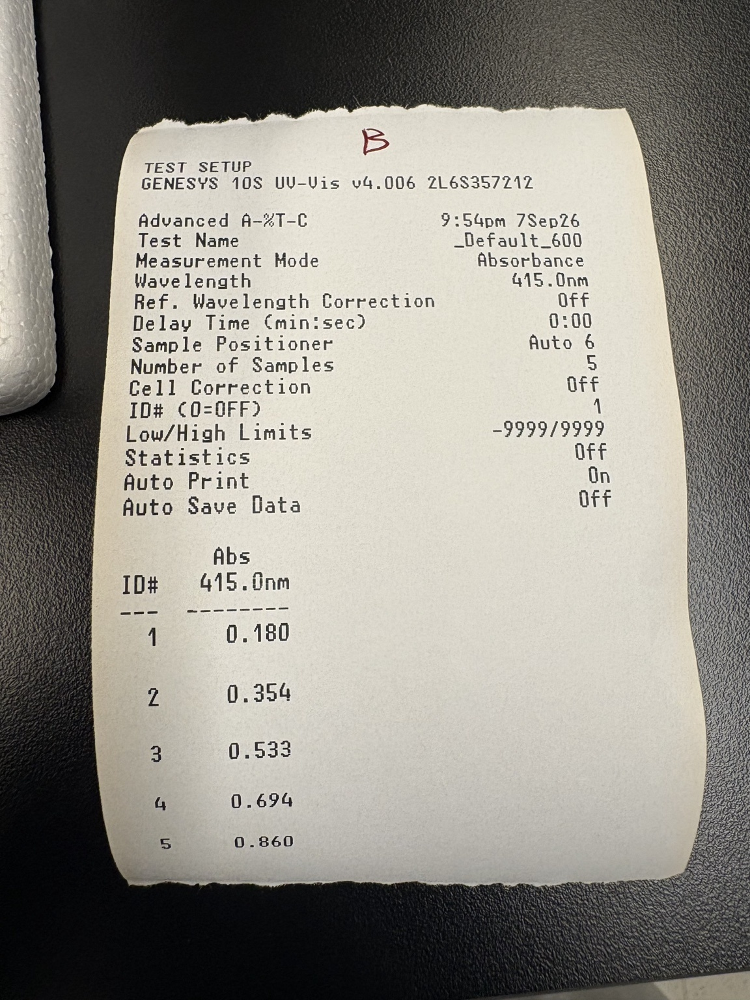 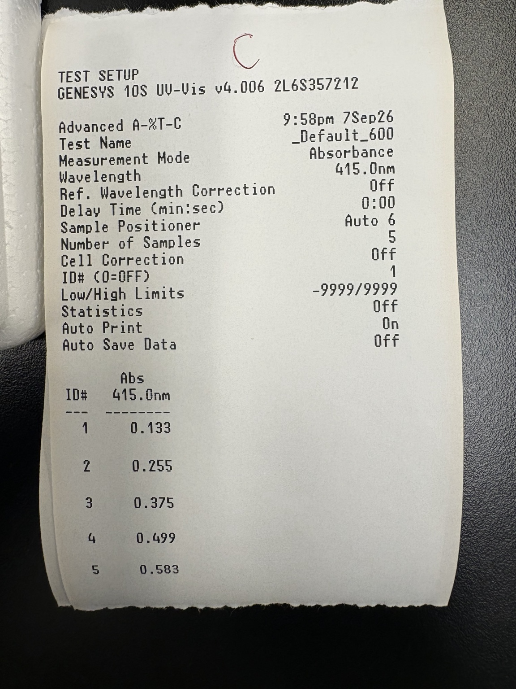 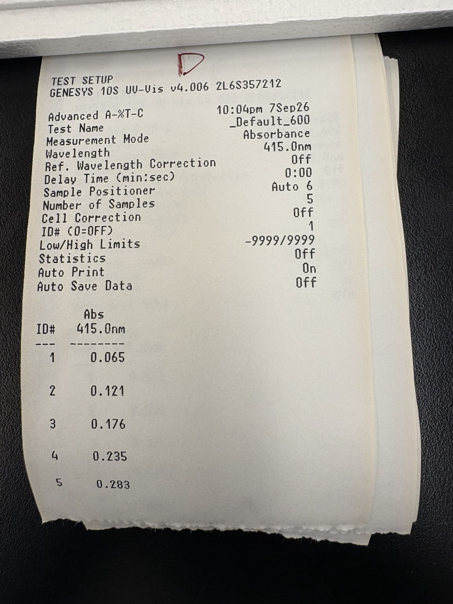 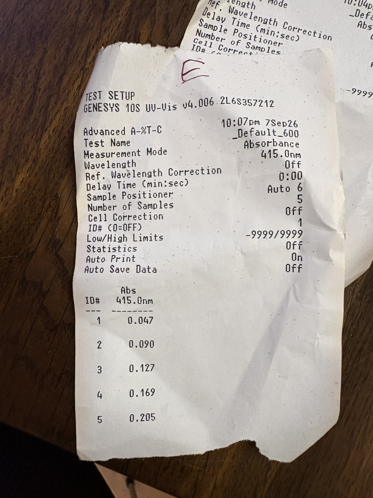

Day 2 (11 Sep 2026, Part III without IPTG, blue labels, tubes A to E):

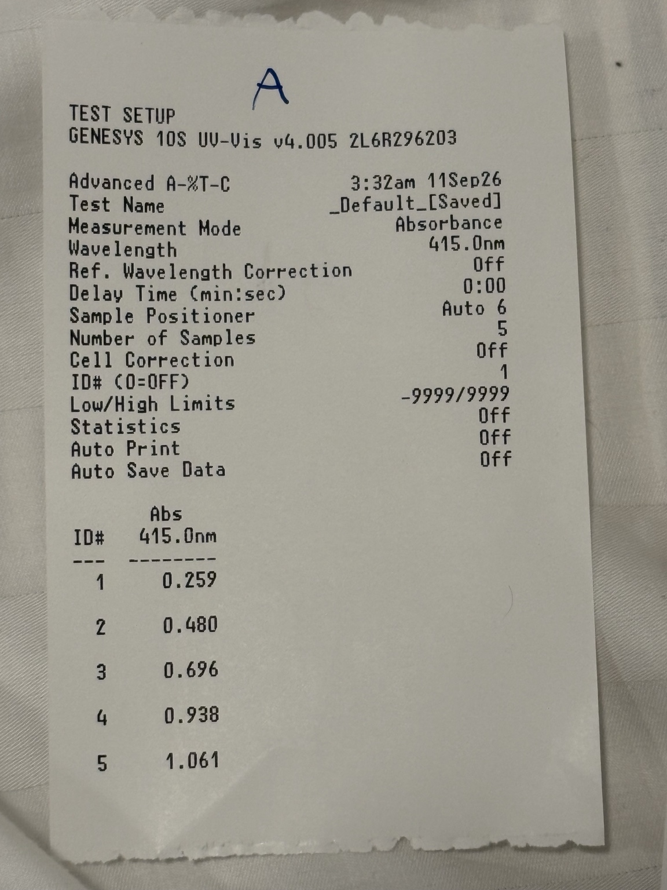 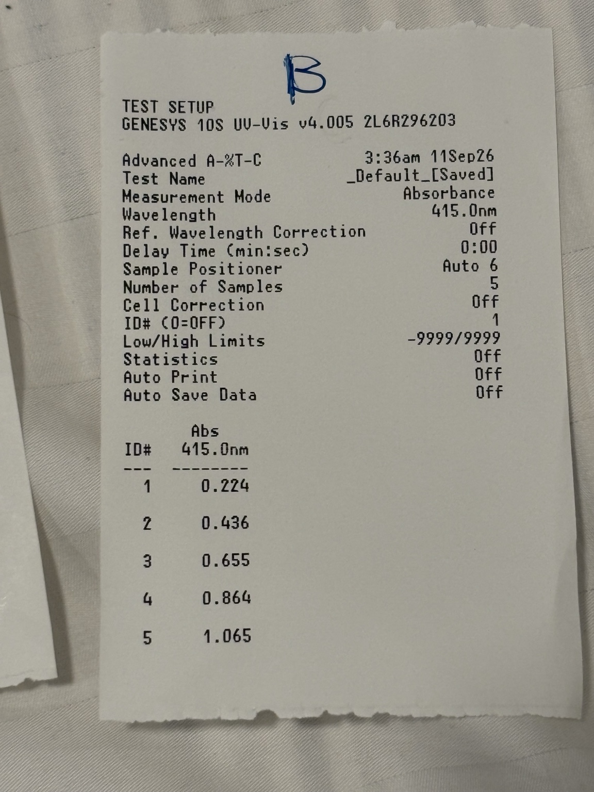 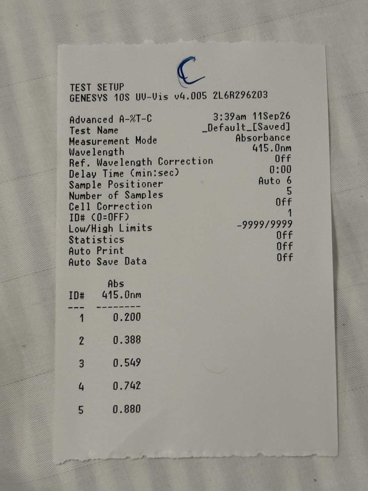 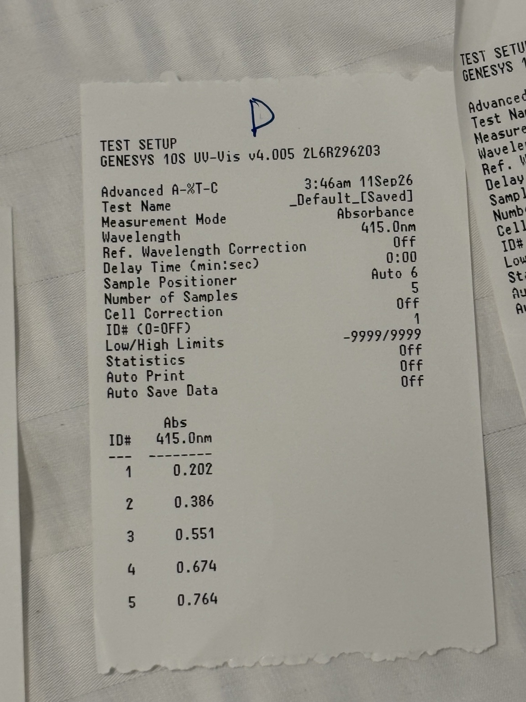 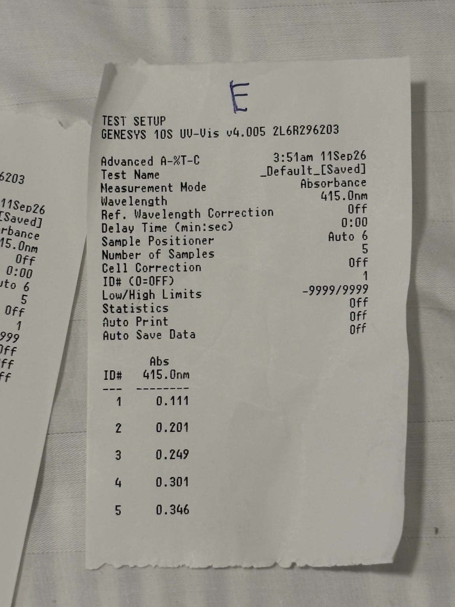

Day 2 (11 Sep 2026, Part III with IPTG, black labels, tubes A to D; tube E discarded before measurement):

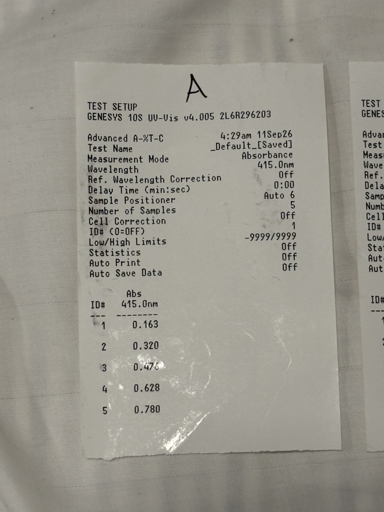 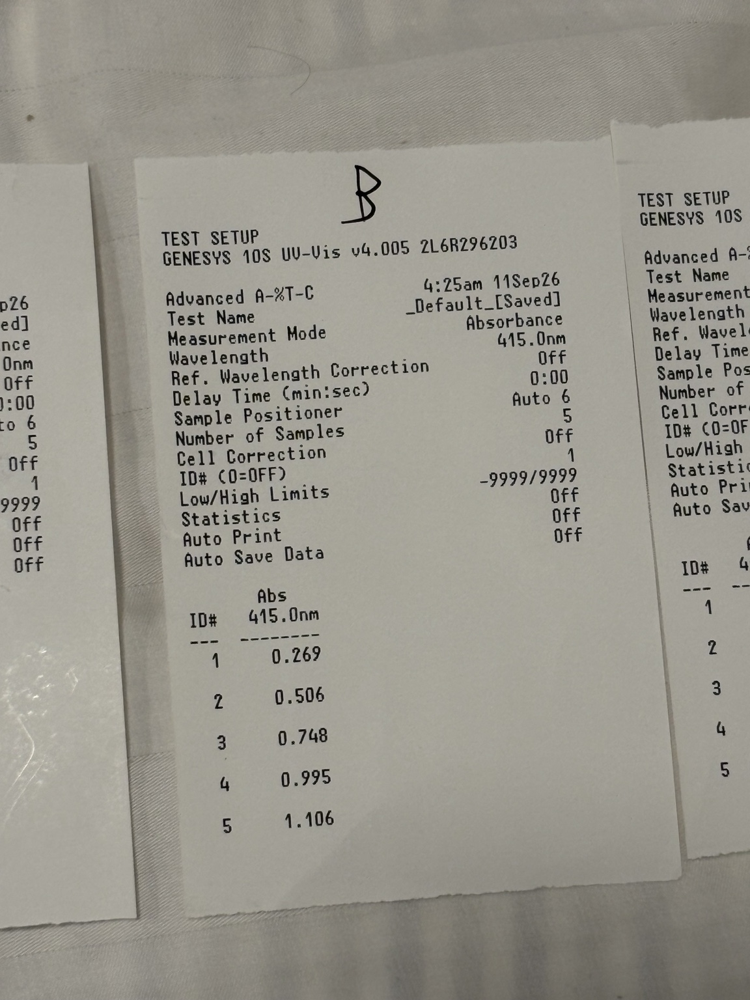 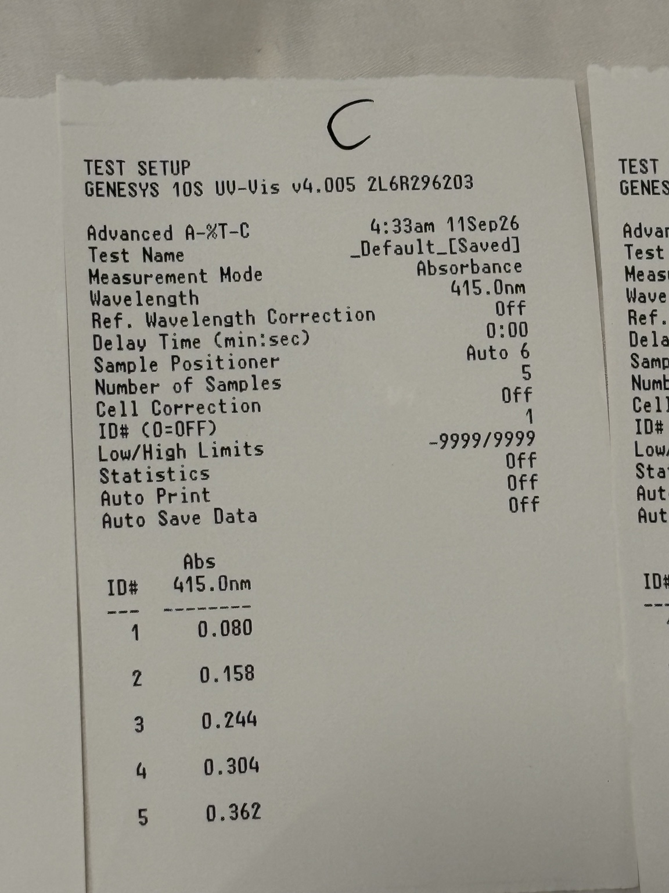 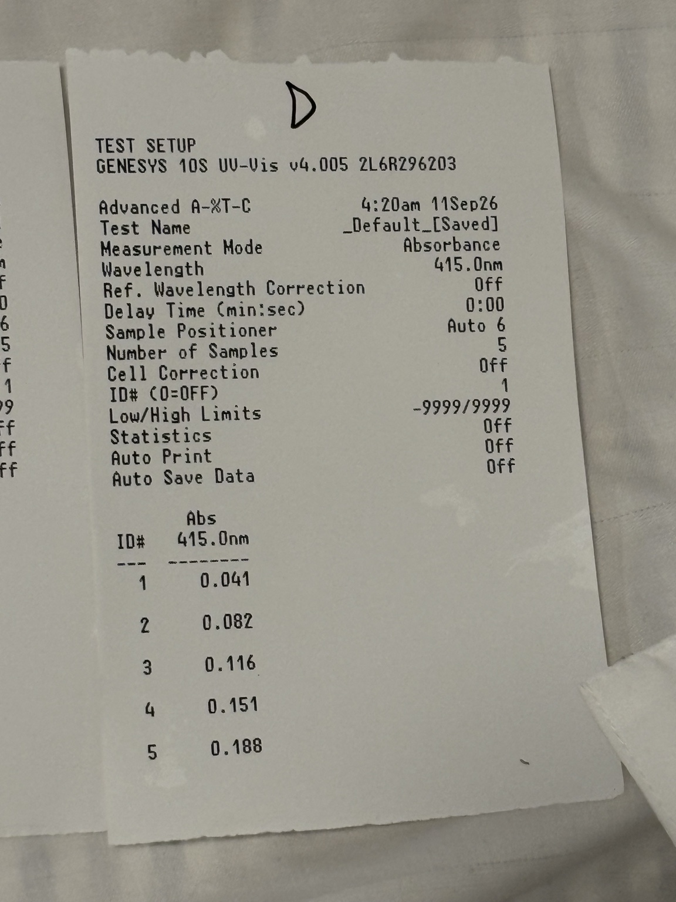
